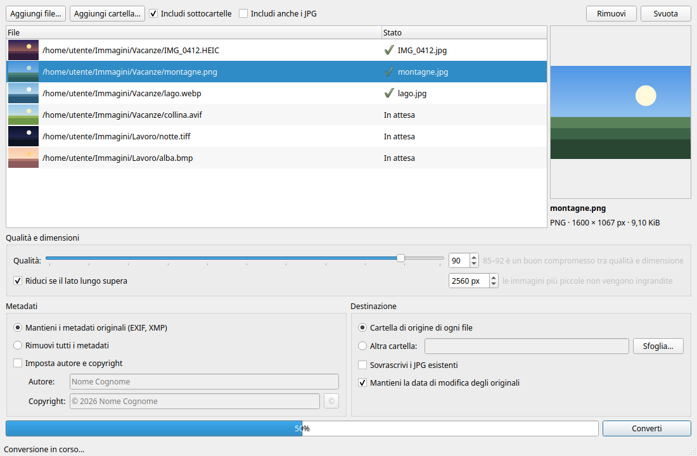

# any2jpg

Semplice applicazione grafica per Linux che converte immagini di qualsiasi formato in JPG,
singolarmente o per cartelle intere, con controllo della qualità e dei metadati.

> **Versione 0.3 beta**: funziona, ma è ancora in fase di test. Segnala i problemi nelle
> [issue](https://github.com/mliistro-beep/any2jpg/issues).



## Funzionalità

- **Formati in ingresso**: HEIC/HEIF (foto iPhone), AVIF, PNG, WebP, TIFF, BMP, GIF, TGA, ICO,
  PPM, PSD e tutti gli altri formati letti da [Pillow](https://pillow.readthedocs.io/).
- **Qualità JPG** regolabile da 1 a 100.
- **Ridimensionamento** facoltativo: riduce le immagini il cui lato lungo supera la misura scelta,
  mantenendo le proporzioni e senza mai ingrandire quelle più piccole.
- **Conversione per cartelle**, con o senza sottocartelle. Si possono anche trascinare file e
  cartelle nella finestra.
- **Anteprime**: miniature nella lista e un pannello con l'immagine selezionata, formato,
  dimensioni in pixel e peso del file (anche per HEIC e AVIF).
- **Veloce**: converte più file in parallelo, sfruttando tutti i core del processore.
- **Riepilogo finale** con i file convertiti, il peso prima e dopo e un pulsante per aprire la
  cartella di destinazione.
- **Metadati**:
  - mantenere quelli originali (EXIF, XMP) oppure rimuoverli tutti (data, fotocamera, GPS…);
  - impostare a mano **autore** e **copyright**, scritti sia in EXIF (Artist, Copyright) sia in
    XMP (dc:creator, dc:rights), con il pieno supporto di © e lettere accentate.
- **Destinazione**: di default la cartella di origine di ogni file; in alternativa una cartella
  a scelta, dove viene ricreata la struttura delle sottocartelle.
- **Nessun file perso**: l'originale non viene mai toccato e i JPG già esistenti non vengono
  sovrascritti (si aggiunge `_1`, `_2`…), a meno di attivare l'opzione apposita.
- **Data dei file**: il JPG può mantenere la data di modifica dell'originale, così resta in
  ordine nei programmi che ordinano le foto per data.
- Gestisce trasparenza (sfondo bianco), rotazione EXIF, CMYK, immagini a 16 bit e profili colore.

## Installazione

Requisiti: Linux, Python 3.10 o successivo con il modulo `venv`
(su Debian/Ubuntu: `sudo apt install python3-venv`).

```bash
git clone https://github.com/mliistro-beep/any2jpg.git
cd any2jpg
./install.sh
```

Lo script installa l'app solo per il tuo utente, senza `sudo`:

| Cosa | Dove |
|---|---|
| Ambiente Python con l'app | `~/.local/share/any2jpg/venv` |
| Comando `any2jpg` | `~/.local/bin/any2jpg` |
| Voce nel menu applicazioni e in "Apri con…" | `~/.local/share/applications/any2jpg.desktop` |

Se PySide6 è già installato nel sistema (pacchetto `python3-pyside6`) viene riutilizzato,
altrimenti viene scaricato (circa 200 MB).

**Aggiornare**: `git pull` e di nuovo `./install.sh`.

**Disinstallare**: `./install.sh --uninstall` (le impostazioni restano) oppure
`./install.sh --purge` (rimuove anche le impostazioni in `~/.config/any2jpg`).

## Uso

Avvia **any2jpg** dal menu applicazioni o dal terminale. Puoi anche aprire subito dei file:

```bash
any2jpg foto.heic cartella/
```

oppure, dal file manager, clic destro su un'immagine → *Apri con* → *any2jpg*.

## Sviluppo

```bash
python3 -m venv --system-site-packages .venv
.venv/bin/pip install --ignore-installed "Pillow>=11.3"
.venv/bin/pip install -e ".[test]"
.venv/bin/python -m pytest
.venv/bin/python -m any2jpg
```

La logica di conversione è in `any2jpg/converter.py` (senza dipendenze dalla GUI, coperta dai
test), l'interfaccia PySide6 in `any2jpg/gui.py`.

## Licenza

[GPL-3.0-or-later](LICENSE) © 2026 Mauro Liistro
